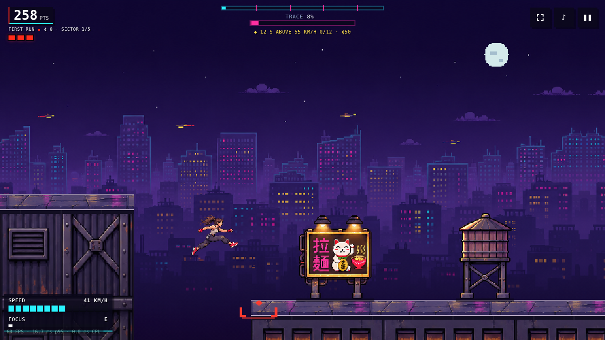
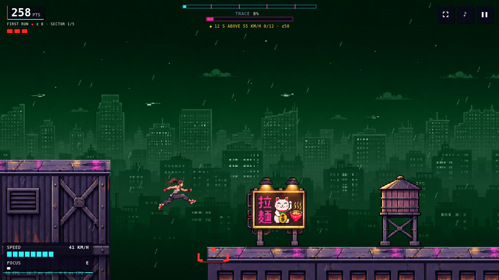
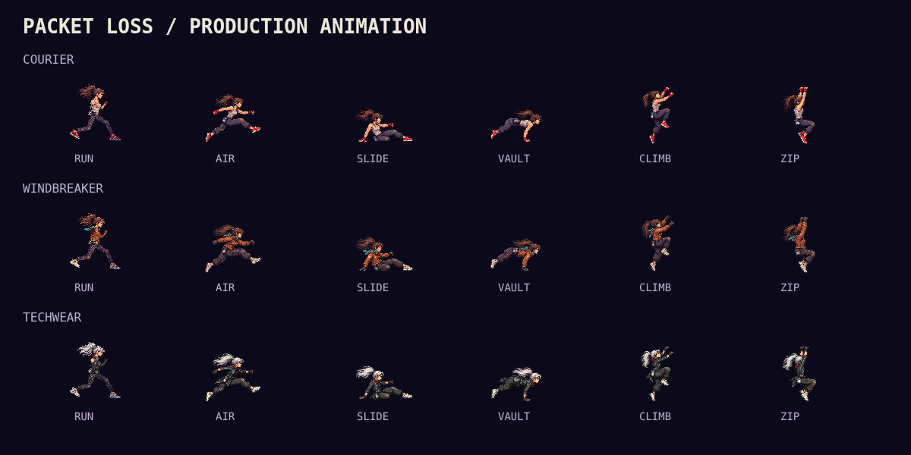

# Art-sheet prototype

The runner is now drawn by the [runner rig](runner-rig.md): one skeleton,
posed live with blended animation and dressed in each outfit's painted parts. The
generated atlases below document the earlier painted versions.

The default game now draws production artwork based on the approved art sheet.
This replaces the earlier incremental procedural pass. It runs the existing
Heist, Endless and Time Trial simulation, including the merged route/contract
changes from master.

## Implementation

- The canvas has twice the previous raster resolution in each axis. World
  coordinates and physics stay in the same units; image assets draw into this
  higher-resolution surface with nearest-neighbour sampling.
- Courier, Windbreaker and Techwear are painted part sheets on one rigged skeleton
  ([runner rig](runner-rig.md)). Every move is posed live and crossfaded:
  running, airborne movement, sliding, vaulting, mantling, hanging, climbing,
  wall-running, ziplines, rolls, stumbles and idle. Ghosts use the same rig
  with a cyan treatment.
- Running phase follows distance travelled. Both feet alternate, planted feet
  track the roof, and each contact drives the footstep sound. Focus and pause
  use the same phase as the visible sprite. See [the gait fix](run-gait.md).
- A 16-cell environment kit supplies the tank, AC, vent, ramen sign, drone,
  crate, overhead pipe, springboard, duct, data shard, wall panel, cables and
  facade materials. Procedural course geometry determines object placement and
  size. Pipe barrels and wall-run panels align with their simulation regions.
- Textured facades, roof slabs and their coping replace the old generated
  facades. Wet roofs expose segmented reflections. A painted scrolling skyline,
  moon, atmosphere and palette treatments supply all five districts.
- Textures, actor frames and district backgrounds are prepared/cached rather
  than resampled or recoloured every frame. Facades are released when their
  chunks leave view or a run restarts; the kit cache is bounded.
- Existing focus slowdown, GPU focus presentation, movement audio hooks,
  hazards, effects, landing cues and loadout perks remain connected.
- The HUD is smaller in landscape and separates the score from the trace meter
  on phones. Artwork files are included in the offline precache.

Append `?art=legacy` (or `&art=legacy` to another query) for the original renderer.
If production images fail to load, the game automatically uses that renderer.
The original F3 art lab still covers the legacy procedural assets. Production
art is checked with the browser harness below and the production pose sheet.

## Verification

- Full unit suite: 21 files / 194 tests passed.
- Asset checks cover all cells in each outfit and kit, irregular grid sizes,
  traversal pose selection and offline precaching.
- Browser render checks cover focus, GPU fallback, workers, rain and portrait.
- `node bench/concept-verify.js` draws 39 outfit/state combinations and drives
  Heist, Endless and Trials over repeated runs; checks bounded caches and resize.
- `node bench/art-review.js --all=1 --tag=concept --out=docs/screenshots/concept`
  captures real game frames in all five districts plus wet Kowloon and portrait.
- Render work stays within the existing budgets without increasing the limits.
  The higher-resolution image composition costs more raster time than the old
  renderer; timings are measured separately from the portable work budgets.

The screenshots are browser captures of the actual game, not generated mockups.
This is a playable prototype: traversal frames are pose-based outside the run
cycle, and the skyline uses a scrolling panorama rather than individually
generated towers.

## Artwork sources and generation prompts

Generated using the built-in image tool with the approved street-worn courier
sheet as the primary reference. Final runtime assets are under
`public/concept-art/`; no runtime image generation or external image host is used.

Prompt set:

1. **Courier atlas:** production 4×4 transparent atlas, 16 equally sized cells,
   no labels/borders/ground/shadows/props, isolated side-view adult female
   courier facing right. Same grim face, untidy brown ponytail, worn ivory top,
   charcoal patched cargo pants, red gloves/shoes, belt pouch. Upper-left light,
   crisp pixel clusters and dark outlines. Reading-order cells: six running
   phases, rising jump, falling landing preparation, slide, speed vault, ledge
   hang, wall climb, wall run, zipline hang, curled roll, alert idle. Preserve
   anatomical scale and gutters so code can slice the regular grid.
2. **Environment atlas:** production transparent 4×4 kit matching the approved
   reference, orthographic side view, purple-gray worn steel and restrained warm
   highlights. Reading-order assets: wood/copper tank on crossbraced legs, fan
   AC, louvered vent, lucky-cat ramen billboard; magenta drone without cone,
   red-edged vault crate, supported horizontal red-banded pipe, red springboard;
   right-angle duct, cyan shard, arrow panel, cables; rectangular wet roof
   material study, concrete/amber-window facade, corrugated riveted facade,
   diagonal red warning panel. No captions, gridlines or joining ground plane.
3. **Skyline:** wide 2:1 side-on nighttime cyberpunk city panorama. No player,
   foreground platforms, UI, title or moon. Ink-purple open sky in upper 40%,
   stepped tower silhouettes, clustered muted amber/cyan/magenta windows,
   purple haze and quiet near-black lower quarter. Similar edge tones for
   alternating mirrored repeats; deliberate pixel clusters without scanlines.
4. **Windbreaker edit:** preserve the courier atlas's exact grid, poses, scale,
   face and transparency; change clothing to a worn burnt-orange sleeved jacket,
   dark patched cargo trousers, off-white shoes, black gloves and short cyan
   scarf, retaining the brown ponytail.
5. **Techwear edit:** preserve that same grid, poses, identity and transparency;
   graphite jacket with short coat tails, muted cyan seams, patched dark cargo
   trousers, off-white shoes, black gloves, short dark-red scarf and pale silver
   ponytail. No weapons, helmets or heavy armour.
