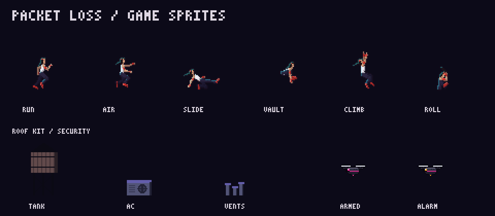
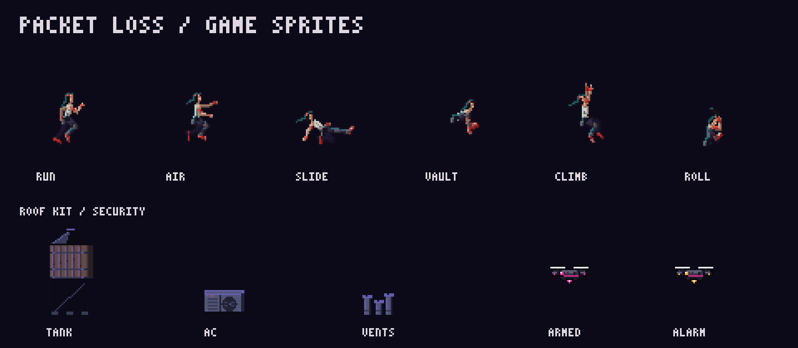

# Street-worn courier and rooftop material pass

First implementation step toward the approved Kowloon concept: the courier
has a weathered ivory top, seams, belt pouch, knee repair, boot scuffs and a
heavier brow. Water tanks gain roof facets and metal hoops; AC units and vents
gain recessed service details; armed/alarm drones gain side pods and a faceted
scanner lens. Roof slabs and chipped coping are baked into existing facades.

The existing skeletal animation, sprite canvases, collision geometry, movement
and security colours are retained. The material detail uses the existing
district palette system, so shared assets also update in the other districts.
This is an incremental native-resolution pass, not a full reproduction of the
higher-detail generated concept. Background art remains procedural.

## Actual sprite comparisons

These sheets use the production sprite renderer and shipped PNGs at 3x nearest
neighbour. They are sprite studies, not gameplay screenshots.

| Before | Proposed |
| --- | --- |
|  |  |

Regenerate with `node scripts/art-sheet.mjs` (pass a checkout path and output
filename to capture another revision).

## Validation

- `npm test`: 19 files, 172 tests passed.
- `npm run build`: passed.
- Local Chromium cannot launch: the execution environment denies the Unix
  socket required by Chromium's process singleton. Browser render checks and
  render-budget checks have not been completed locally.
- The art-review CI job runs unit tests, builds, and captures the same seeded
  Heist frame on the PR base and proposed branch in dry/wet Kowloon and phone
  portrait. Download its `art-review` artifact to inspect gameplay frames.
  Run `node bench/art-review.js` to reproduce; `CHROMIUM_PATH` can select an
  installed browser. Existing render-budget and long-run CI remain in place.

Gameplay screenshots and performance checks must be reviewed before merging.
