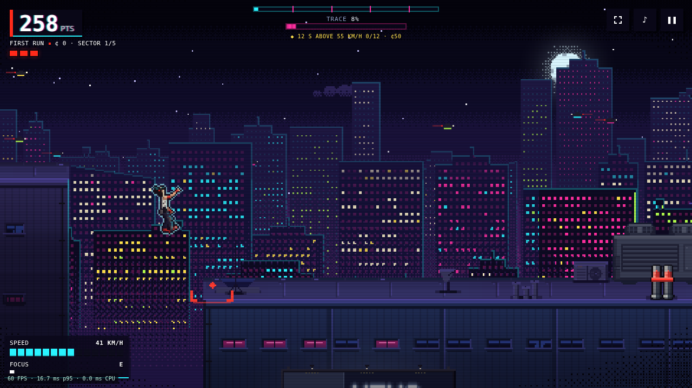
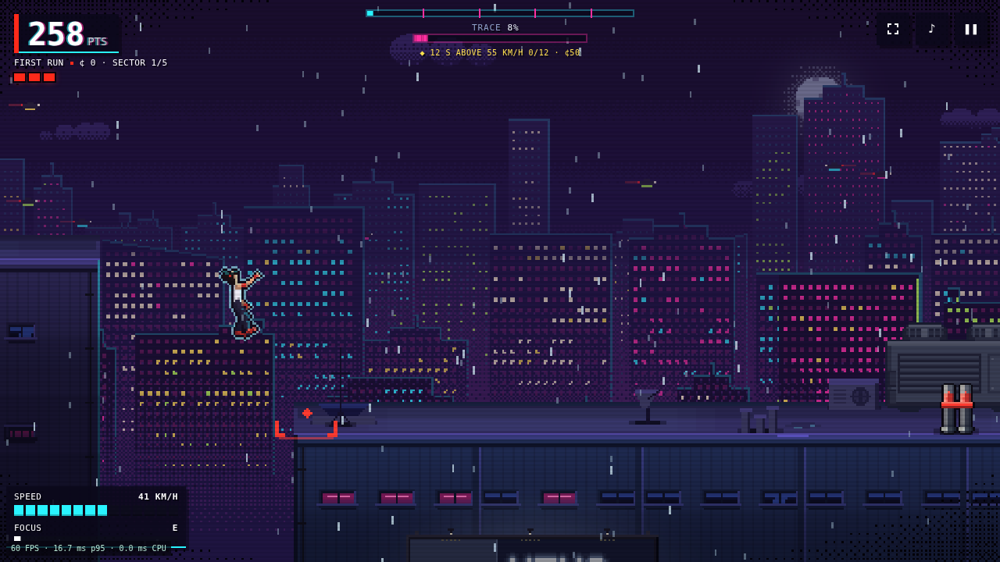
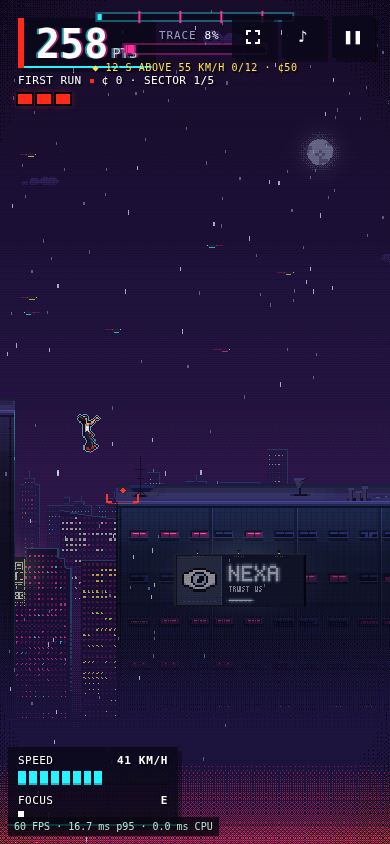

# Street-worn courier and rooftop material pass

First implementation step toward the approved Kowloon concept: the courier
has a weathered ivory top, seams, belt pouch, knee repair, boot scuffs and a
heavier brow. Water tanks gain roof facets and metal hoops; AC units and vents
gain recessed service details; armed/alarm drones gain side pods and a faceted
scanner lens. Roof slabs and chipped coping are baked into existing facades.

The existing skeletal animation, sprite canvases, collision geometry, movement
and security colours are retained. The material detail uses the existing
district palette system, so shared assets also update in the other districts.
This is an incremental native-resolution pass, not a full reproduction of the
higher-detail generated concept. Background art remains procedural.

## Actual sprite comparisons

These sheets use the production sprite renderer and shipped PNGs at 3x nearest
neighbour. They are sprite studies, not gameplay screenshots.

| Before | Proposed |
| --- | --- |
|  |  |

Regenerate with `node scripts/art-sheet.mjs` (pass a checkout path and output
filename to capture another revision).

## Gameplay screenshots

The same seeded Heist frame (420 ticks) on current master and the proposed
branch. CSS transitions are finished for capture; simulation time and weather
are fixed. Fonts are blocked for consistent fallback typography.

| Scene | Before | Proposed |
| --- | --- | --- |
| Kowloon dry |  |  |
| Kowloon wet |  |  |
| Phone portrait |  |  |

## Validation

- `npm test -- --maxWorkers=1 --testTimeout=30000`: 20 files, 190 tests passed
  after merging current master. A prior parallel run timed out one art test
  at its default five-second limit; the serial rerun passed.
- `npm run build`: passed.
- `npm run test:render`: passed with Playwright's headless shell (the system
  Chromium executable requires a Unix socket unavailable in this environment).
- `npm run bench:check`: all scenarios within budget.
- The art-review CI job runs unit tests, builds, and captures the same seeded
  Heist frame on the PR base and proposed branch in dry/wet Kowloon and phone
  portrait. Download its `art-review` artifact to inspect gameplay frames.
  Run `node bench/art-review.js` to reproduce; `CHROMIUM_PATH` can select an
  installed browser. Existing render-budget and long-run CI remain in place.

CI uses Ubuntu 24.04, since the pinned Playwright version does not support the
Ubuntu 26.04 image now selected by `ubuntu-latest`.
