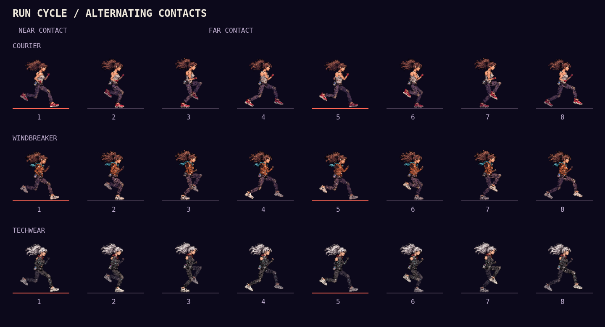

# Running gait and sound

The old six-frame sequence repeated the same leading leg, trimmed each frame
to a different origin, and sampled wall-clock time multiplied by current speed.
Footstep audio came from the separate legacy skeleton clock. Accelerating could
skip poses, focus slowed the audio without slowing the sprites, and legs jumped
between unrelated silhouettes.

Running now uses six illustrated parts for each outfit, baked at startup into
64 frames with one fixed pelvis/ground registration. Two-bone leg solving keeps
thigh and shin lengths constant, bends knees forwards and supplies heel recovery.
The far limbs have a darker treatment and arms counter-swing. Existing traversal
poses remain in use outside running; ghosts use their own distance-driven gait.

A full left/right stride covers 4.2 world metres. Stance lasts 36% of a cycle;
the planted ankle travels backwards by the exact ground distance. The renderer
advances phase from interpolated player position and triggers footstep audio at
the same half-stride contacts. It does not advance during pause, idle or flight,
and resets on a new run or teleport. Landing retains its existing impact sound.
The running rig is pre-baked; gameplay still draws one cached image per runner.

The leg art is scaled along and across each bone separately, with a corrected
thigh pivot, to avoid doubled, bulky knees. The pelvis now sits higher with a
smaller bounce. Shoe bounds are shared by the pose solver and renderer: heel
strike and toe-off lift the ankle so the lowest sole corner stays on the roof.
The recovery uses a continuous Hermite path with matching horizontal velocity
at contact and toe-off instead of stopping at every intermediate pose. Tests
cover sole clearance, constant bone lengths and continuity at recovery keys.

## Review

[Actual gameplay recording with live game audio](screenshots/gait/gameplay-with-audio.mp4)

`node bench/gait-review.js` checks the actual game's audio callbacks against its
rendered gait across all three outfits, focus and pause, and writes the stride
sheet. `--record` also records ten seconds of actual gameplay with Web Audio
mixed into the canvas recording (WebM). The checked-in MP4 is a transcode of that
recording. `tests/runGait.test.js` checks speed/draw-rate independence, contact
alternation, focus, transitions, teleport reset, stance registration and bone
lengths across the cycle. CI runs both the unit and browser checks.

## Illustrated parts

- `public/concept-art/courier-rig.png`
- `public/concept-art/windbreaker-rig.png`
- `public/concept-art/techwear-rig.png`

Each is a transparent 3-column × 2-row kit, in reading order: head/torso,
upper arm, forearm/glove, thigh, shin, right-facing shoe. Joint coordinates in
`src/pixel/runRig.js` are normalized to the trimmed cutouts. Preserve those
proportions when editing the parts.

Generated with the built-in image tool, using the existing courier atlas as
the identity/style reference. Prompt: disassembled animation puppet kit with
exactly six isolated parts in a regular 3×2 grid, head and torso without limbs,
straight downward arm/leg segments with overlapping rounded joints, a separate
right-facing sneaker, crisp dark outlines, transparent gutters, no scenery or
labels. A second extraction pass removed background haze. Outfit edits kept
the part positions and proportions: worn orange jacket/cyan scarf, black gloves
and off-white sneakers for Windbreaker; graphite jacket/cyan seams, dark-red
scarf, silver ponytail, black gloves and off-white sneakers for Techwear.
