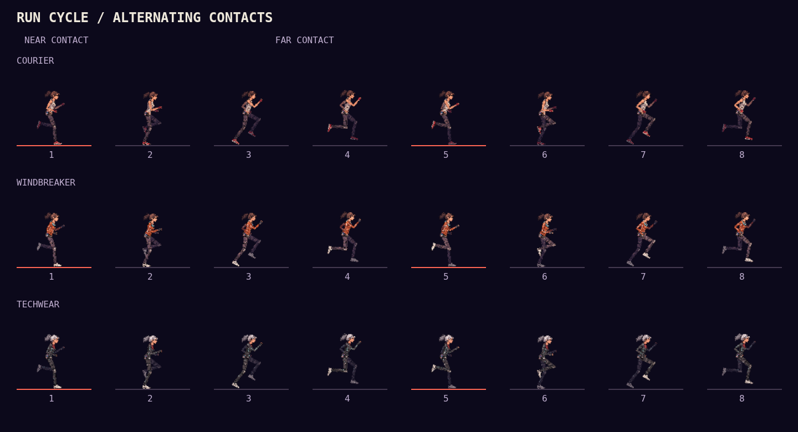

# Running gait and model registration

Running uses the [v2 model parts and measurements](runner-v2.md). The full
left/right stride covers 4.2 world metres, and stance lasts 24% of a cycle.
Phase advances from interpolated player position; footstep audio fires at the
same alternating half-stride contacts. Focus slows both motion and audio,
pause stops them, and new runs, teleports and airborne transitions reset the
contact phase. Ghosts have an independent gait clock.

The pose solver keeps thigh and shin lengths constant. Grounded ankles track
the roof while each shoe rolls about its heel or toe. Continuous Hermite
recovery matches ankle and shoe-angle velocity at lift-off and strike. In
flight, the shoe follows the solved shin with a small ankle flex rather than
holding an unrelated angle in world space. All four shoe corners are checked
for clearance through the full cycle.

All outfits use the same `runnerModel.js` anatomy in running and traversal.
Shoulders follow torso lean; the separate head counter-tilts, and its ponytail
has a delayed wave toward the tips with a fixed attachment at the tie. Fists
are independent images registered along the wrist-to-knuckle axis.

`runRig.js` bakes 64 running frames and 16 traversal poses per outfit into
128×128 transparent canvases. Every pose uses the same origin and limb lengths;
gameplay still draws one image per actor, including ghost treatment.

## Review



[Interactive cycles](screenshots/runner-v2/run-cycle.html) ·
[Synchronized merged-v1/v2 comparison](screenshots/runner-v2/stride-comparison.html) ·
[Gameplay with audio](screenshots/runner-v2/gameplay-with-audio.webm)

The comparison includes all three outfits, slow playback, frame scrubbing and
skeletal overlays. Download and open the HTML locally; it is self-contained.

```sh
node bench/gait-review.js --out=docs/screenshots/runner-v2 --compare=ff2f62a --record
```

The browser check matches actual game audio callbacks to rendered contacts,
checks focus and pause, and checks that none of the 240 cached model frames
clips its canvas edges. Unit coverage includes distance-driven phase, contact
alternation, fixed bone lengths, sole registration, recovery continuity,
ankle angles, arm and hand alignment, the hair loop and traversal dimensions.
