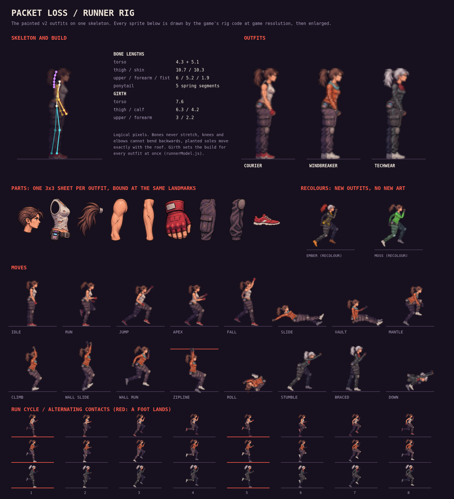
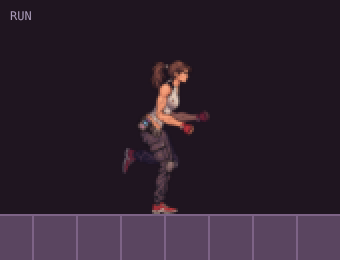
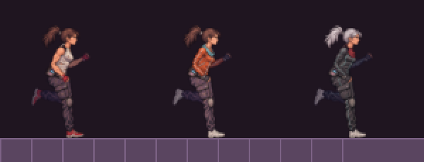

# Runner rig

The runner is one skeleton, posed every frame from the simulation, and
dressed in an outfit's painted parts. Courier, Windbreaker and Techwear are
three part sheets bound to that skeleton at the same landmarks and drawn at
the same build, so an outfit changes the surface and never the rigging,
proportions or animation.







## How it fits together

| File | Job |
| --- | --- |
| `src/pixel/runnerModel.js` | Bone lengths, girth and taper (the build), shoe and sprite frame |
| `src/pixel/rig/skeleton.js` | Bones, pose channels, forward kinematics, two-bone IK, roof registration |
| `src/pixel/rig/clips.js` | Authored key poses per move, spline sampling, the run pose from the gait |
| `src/pixel/rig/animator.js` | Simulation state → pose: crossfades, landing squash, ponytail physics |
| `src/pixel/rig/parts.js` | Binds the nine painted parts to the bones and draws a solved pose |
| `src/pixel/rig/skins.js` | Outfit definitions: a part sheet, optionally recoloured |
| `src/pixel/runGait.js` | Distance-driven stride, planted feet and footstep timing (unchanged) |

**Skeleton.** Bone lengths come from `runnerModel.js` and never change.
A pose is a flat record of angles (`lean`, `nThigh`, `nKnee`, `fArm`, …),
so any two poses blend channel by channel. Knee and elbow flex are clamped
when solved, so no blend can bend a joint backwards.

**Animation.** Each move is a short clip of key poses sampled with a
Catmull-Rom spline, so motion carries its speed through each key instead of
stopping on it. Clips are timed by what the simulation knows: vault and
mantle by kinematic progress, air poses by vertical speed, roll by its
duration (crouch, tuck and come up running, turning once at a steady rate
about the body's centre and kept on the roof), climb
and zip as loops. The run is not keyed. It converts the existing gait's
planted-foot IK into joint angles, so footsteps, sounds and the visible
contact stay in lockstep.

On every state change the animator crossfades from the pose currently on
screen over 60–300 ms. Landings drop the pelvis with the feet held in
place by IK, scaled by how hard you hit the roof. The ponytail is a damped
five-segment spring chain driven by the body's real motion, and the painted
ponytail is laid along it, so it streams back at speed, lifts when falling
and whips through rolls.

**Follow-through.** The chest, head, elbows and wrists do not track the pose
directly. Each chases it on a damped spring (`FOLLOW` in `animator.js`), so
they arrive a beat late and overshoot a little whenever the body changes
what it is doing. The torso also tips with acceleration, forward when
speeding up and back when braking. In the run the ribcage twists against the
hips, the chest gives with each footfall, and the forearm whips through the
swing; in the air the legs keep working and the arms feel for balance.

**Drawing.** Each outfit is a transparent 3×3 sheet of nine parts, in
reading order: head, torso, ponytail; upper arm, forearm, fist; thigh, shin,
shoe. `parts.js` binds each part to its bone at fixed landmarks (`BIND`),
measures the part's real opaque width across the bone, and bakes it once to
working resolution with stepwise filtering. Per frame a part is only rotated
about its joint. The sprite is drawn at twice the screen's resolution and
averaged down onto whole device pixels, which is what keeps the painted
detail clean at game size. Far limbs are darkened copies.

**Build.** `GIRTH` in `runnerModel.js` is the thickness of each part across
its bone and `TAPER` varies it along the bone (full hips and thighs narrowing
to the knee, calves narrowing to the ankle). Both apply to every outfit, so
the build is tuned in one place without touching the artwork or the skeleton.

## Adding an outfit

Add an entry to `SKINS` in `src/pixel/rig/skins.js`.

**From new art:** paint a 3×3 sheet with the nine parts in the same order
and roughly the same framing as `public/concept-art/v2/courier-rig.png`, put
it in `public/concept-art/`, and name it:

```js
medic: defineSkin({ name: 'Medic', sheet: 'v2/medic-rig.png' }),
```

**As a recolour:** reuse an existing sheet and describe the colour changes.
No new art is needed and alpha is never touched, so the silhouette cannot
change:

```js
moss: defineSkin({
  name: 'Moss',
  sheet: 'v2/windbreaker-rig.png',
  recolor: {
    torso: { where: [5, 40], hue: 95, sat: 0.8 },   // the orange jacket goes green
    upper: { where: [5, 40], hue: 95, sat: 0.8 },
    fore: { where: [5, 40], hue: 95, sat: 0.8 },
    shoe: { tint: '#35e0ff' },
  },
}),
```

Keys are part names (`head`, `torso`, `hair`, `upper`, `fore`, `hand`,
`thigh`, `shin`, `shoe`) or `all`. A rule, or an array of rules, takes:

| Field | Effect |
| --- | --- |
| `hue` | Rotate the hue by this many degrees |
| `tint` | `'#rrggbb'`: take this colour's hue and saturation, keep the painted shading |
| `sat`, `light` | Multiply saturation or lightness |
| `where` | `[fromHue, toHue]`: only touch pixels in this hue range, e.g. a red glove but not the fingers |

The model sheet shows two recolours built this way. Sheets listed in `SKINS`
are loaded at startup; add a new sheet to the offline precache list in
`vite.config.js`.

The rig draws whatever `view.setRunner(id)` names. To offer an outfit on the
title screen today, register its id in `RUNNERS` and `RUNNER_STYLES`
(`src/pixel/runner.js`, which also feeds the legacy renderer and unlocks)
and give it a Heist loadout in `LOADOUTS` (`src/sim/heist.js`). Runner
selection currently ties a look to a loadout.

## Adding or tuning a move

Edit the key poses in `CLIPS` (`clips.js`). Values are radians:
limb angles are measured forward from hanging straight down, `lean` tilts
the torso forward, and `nKnee`/`nElbow` are flex. Grounded clips are lifted
onto the roof automatically. Map a new simulation state in `clipFor` and
`sampleState`, and give it a blend-in time in `BLEND` (`animator.js`).

## Review

```sh
node bench/rig-sheet.js        # model sheet + animated run cycle and moves
node bench/gait-review.js      # footstep audio vs rendered contacts in the real game
node bench/concept-verify.js   # every state and outfit, all modes, cache bounds
```

Unit tests (`tests/runnerRig.test.js`) cover fixed bone lengths through
every move and mid-blend, knees and elbows never hyperextending, run soles
planted and moving with the roof, grounded poses on the roof, transitions
between every pair of states without a pop, one turn per roll with no
unwinding, landing squash without foot sliding, ponytail stability through
teleports, ghosts without kinematic data, nine parts in every outfit sheet
and recolours that leave alpha alone. `bench/concept-verify.js` checks in a
browser that no outfit clips the sprite frame in any state.
