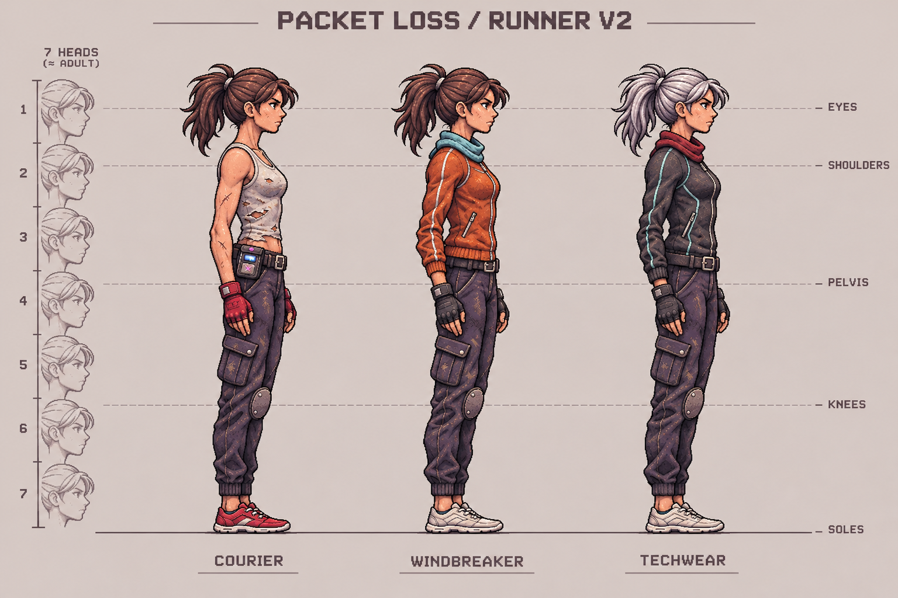
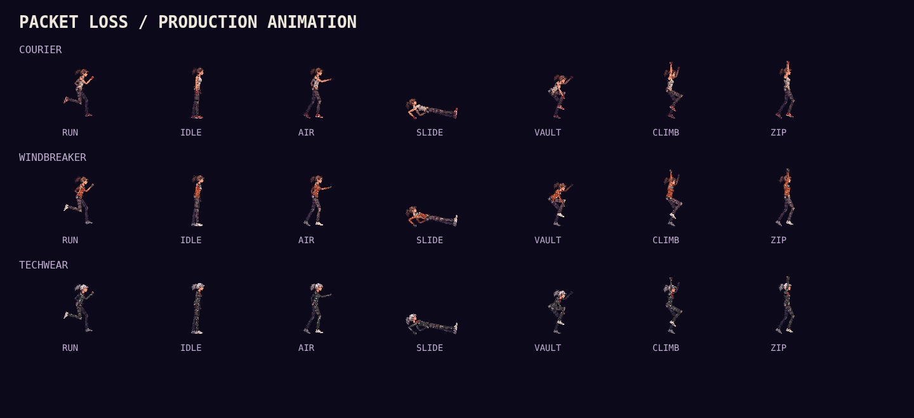
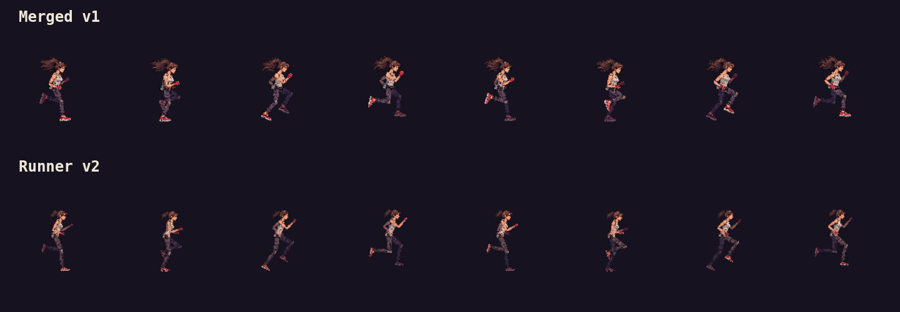
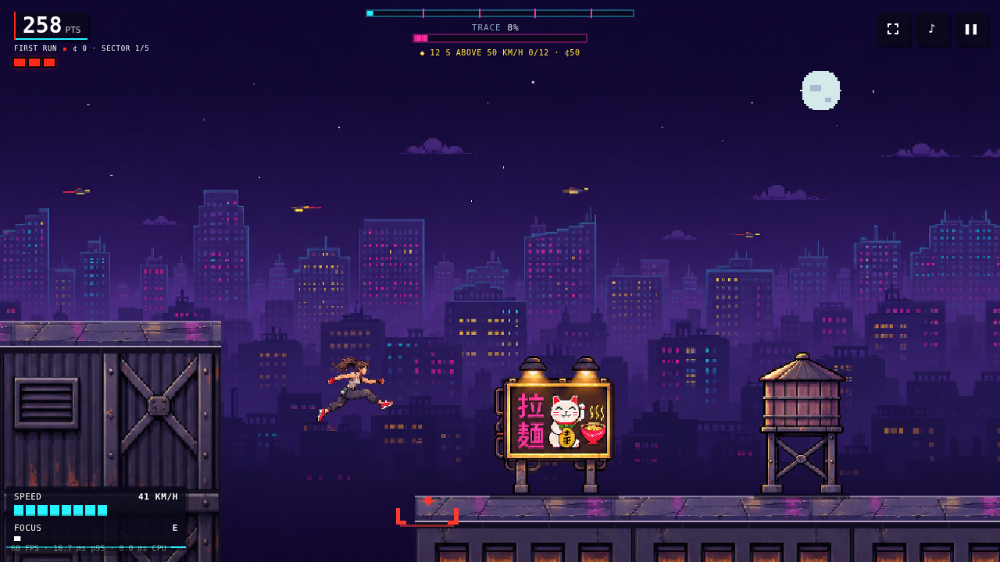
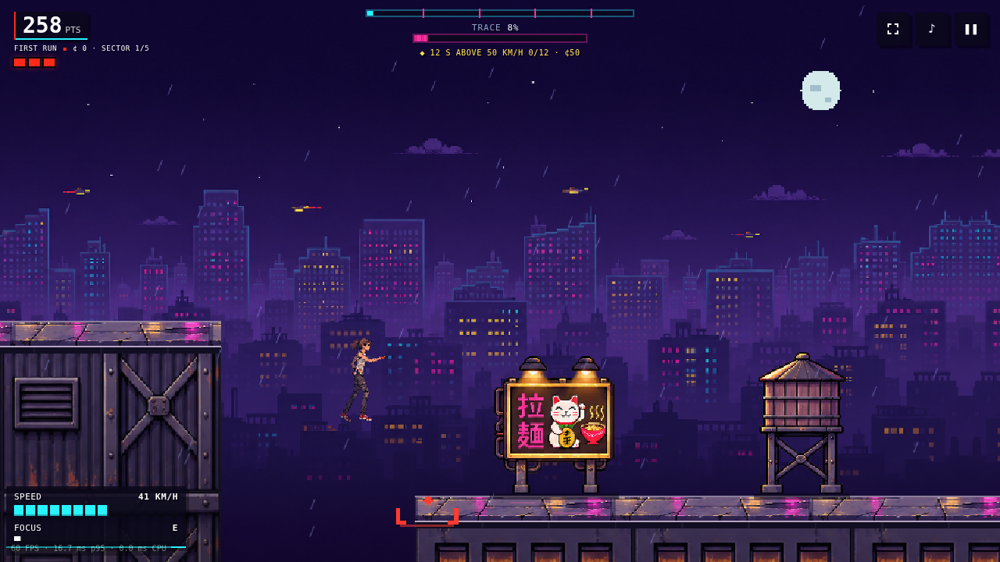
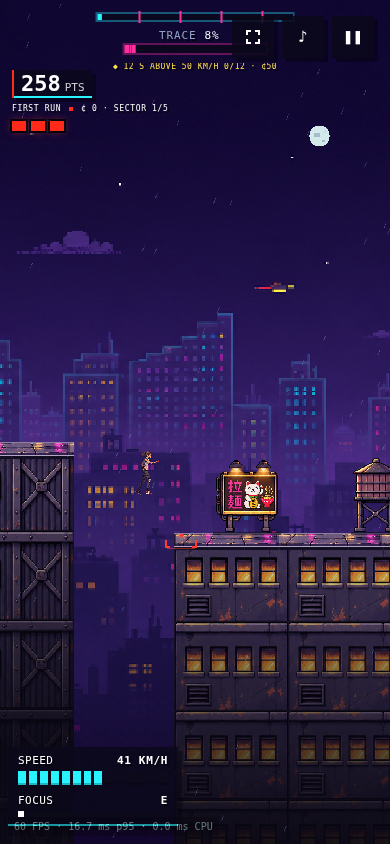

# Runner models v2

The runner now has a leaner adult silhouette across Courier, Windbreaker and
Techwear: a smaller head and ponytail, longer legs and forearms, narrower cargo
trousers, readable fists, and low-profile shoes with thinner soles. The three
outfits share one anatomical model. Their clothing changes the surface detail,
not the body's proportions.

## New design sheet



This image is a design reference generated with the built-in imagegen tool.
The screenshots and motion studies below are captured from the production
renderer using the new parts, not generated gameplay mockups.

## Actual production artwork





[Download the synchronized v1/v2 comparison](screenshots/runner-v2/stride-comparison.html).
Open the self-contained HTML locally. It includes slow motion, frame scrubbing,
skeleton overlays and an outfit selector for all three models. Both revisions
are aligned at the same world scale and ground origin; neither is enlarged to
make it look more detailed.

[All three running cycles](screenshots/runner-v2/run-cycle.html) ·
[Actual gameplay with audio](screenshots/runner-v2/gameplay-with-audio.webm)

| View | Merged v1 | Model v2 |
| --- | --- | --- |
| Kowloon |  |  |
| Wet Kowloon |  |  |
| Phone |  |  |

## Production parts and registration

Each transparent 3×3 sheet has nine isolated parts, in reading order:
head/neck, torso, ponytail; upper arm, forearm, fist; thigh, shin, shoe.

- [Courier kit](../public/concept-art/v2/courier-rig.png)
- [Windbreaker kit](../public/concept-art/v2/windbreaker-rig.png)
- [Techwear kit](../public/concept-art/v2/techwear-rig.png)

`runnerModel.js` owns model-space lengths shared by every outfit and pose:
10.7 thigh, 10.3 shin, 9.4 hip-to-shoulder, 6.0 upper arm, 5.2 forearm and
1.9 wrist-to-knuckles. Shoe bounds are 6.2×3.0, down from 7.6×4.3. Physics,
collision geometry, running stride distance and footstep cadence are unchanged.

`runRig.js` registers each cutout to its actual joints and measures opaque width
across each source bone before scaling it to the model's specified thickness.
This avoids making jacket sleeves or trouser segments wider because their
source image happens to have a larger crop. The single knee patch belongs to
the shin. The head and ponytail are separate from the torso; head counter-tilt
and a small delayed hair wave remain independent of body lean.

Running still uses 64 cached frames per outfit, and traversal uses 16 cached
poses built from those same nine parts. Idle, jumping, sliding, vaulting,
climbing, hanging, wall-running, zipping and rolling keep the same limb lengths
and ground registration. Gameplay draws one cached image per actor. The 128×128
frame includes transparent headroom for raised arms; frame bounds are checked
for all 240 cached outfit/pose images.

The v1 images remain available for historical comparisons but are no longer
loaded or precached by the production renderer. The new three kits, skyline
and environment kit are the production downloads.

## Reproduce the review

```sh
node bench/gait-review.js --out=docs/screenshots/runner-v2 --compare=ff2f62a --record
node bench/concept-verify.js --out=docs/screenshots/runner-v2
node bench/art-review.js --out=docs/screenshots/runner-v2 --tag=after
```

The baseline of the motion comparison is the merged v1 commit `ff2f62a`.
Gameplay before/after captures use the same seed, district, weather and tick.
CI regenerates the model sheets and gameplay captures as review artifacts.

The [generation prompts and provenance](runner-v2-prompts.md) document the
built-in imagegen calls, references and final saved assets.

## Validation

- Full unit suite: **217 tests pass across 22 files**.
- Browser model review: **240 cached images** checked for clipping and
  **195 footsteps matched 195 rendered contacts**, including focus and pause.
- All **39 outfit/state combinations**, repeated Heist/Endless/Trials runs,
  bounded renderer caches and portrait resizing pass.
- Interactive comparison: all three outfit selections produce distinct
  images; frame scrubbing, skeletal overlays and phone resizing pass.
- Renderer smoke checks pass: FPS toggle, focus pixel parity and fallback,
  worker jobs, skyline parity, rain and portrait handling.
- Production build and existing render-work budgets pass; no limits raised.
- Repeated-run memory check: four 1200-frame Heists pass. Canvas count stays
  at 370 and canvas storage at 80.9 MB from run to run; no cache/DOM growth.

Traversal still uses deliberate static poses, rather than full blended cycles
for every action. The new model and anchors are shared across those poses;
this pass does not change gameplay physics or collision dimensions.
